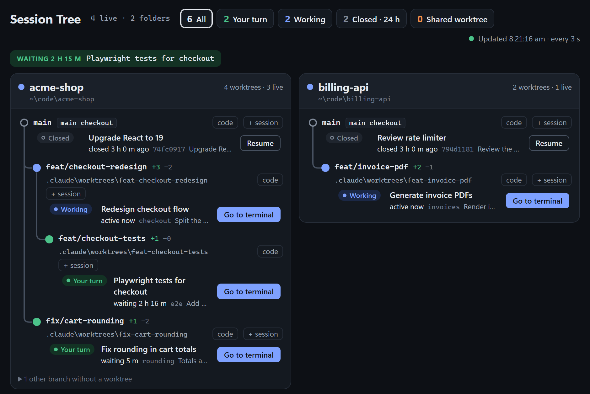

# Session Tree

A local dashboard for people who run several Claude Code CLI sessions at once. It shows every repo you are working in as a card. Each card holds a git graph of your worktrees, showing which branch forked from which, with the live and recently closed Claude Code sessions attached to the branch they run on. From a card you can jump back to a session's terminal tab, resume a closed session, start a new one, or open the worktree in VS Code.

Once installed, it runs in the system tray, starts when you sign in, and shows the dashboard at http://127.0.0.1:4317 in its own window.



*The repos, branches and sessions in this screenshot are mock data.*

## Current scope

The tool is in development and shared for team trial. For now it supports only this setup:

- **Windows** (Windows 11). No macOS or Linux.
- **Claude Code CLI** sessions. Not the Claude desktop app, Codex CLI or other agents.
- **VS Code** as the editor for the **code** button. Not Cursor or other editors.

Support for more platforms, agents or editors may come later; this README will be updated when it does. Please report anything odd (see [Feedback](#feedback)).

## Prerequisites

Install all of these before setup. Run the checks in PowerShell. Versions are the ones tested on 2026-10-12.

| Tool | How to check | Tested with | Used for |
|---|---|---|---|
| Windows 11 | `(Get-CimInstance Win32_OperatingSystem).Caption` | 11 Pro, build 26200 | everything |
| [Claude Code CLI](https://docs.anthropic.com/en/docs/claude-code) on PATH | `claude --version` | 2.1.296 | the sessions it shows, Resume, + session |
| [uv](https://docs.astral.sh/uv/) on PATH | `uv --version` | 0.8.22 | installs Python 3.12+ and the dependencies |
| Git on PATH | `git --version` | 2.51.0 | branch graph (2.41 or later is faster) |
| Windows Terminal | `(Get-AppxPackage Microsoft.WindowsTerminal).Version` | 1.24 | Go to terminal, Resume, + session |
| VS Code (its installer registers `vscode://` links) | `Test-Path Registry::HKEY_CLASSES_ROOT\vscode` should print `True` | 1.108.0 | the **code** button |
| Microsoft Edge (comes with Windows 11) or Google Chrome | `Test-Path "${env:ProgramFiles(x86)}\Microsoft\Edge\Application\msedge.exe"` should print `True` | Edge | the dashboard's own window |

## What you get

- **One card per repo** with a session, sorted so busy repos come first.
- **Branch graph per repo:** worktrees nest under the branch they forked from, with `+ahead −behind` counts. The graph also shows:
  - Grey dashed nodes for branches that have no worktree but are a parent, and for bases such as `Dev` or `origin/Dev`.
  - A "merged into origin/Dev" label on branches that are already merged.
  - An orange "22 behind origin/Dev" warning when your local base is stale.
  - Branches with no worktree and no children, folded into "N other branches".
- **Session status:** Working, Your turn (with how long it has waited), or Closed (kept for 24 hours).
- **Alerts** for two live sessions sharing one worktree, sessions waiting over 2 hours, and sessions whose worktree switched branch.
- **Buttons on each row:**
  - **Go to terminal:** brings the session's existing Windows Terminal tab to the front.
  - **Resume:** reopens a closed session in a new window.
  - **+ session:** starts a new Claude Code session in that worktree, in a new window.
  - **code:** opens the worktree in VS Code through a `vscode://file/` link and brings its window to the front. The first time, the browser asks whether to open Visual Studio Code; tick "Always allow" to skip the prompt next time.

## Setup

1. **Install uv** if `uv --version` fails. Use either command from the [uv install docs](https://docs.astral.sh/uv/getting-started/installation/):

   ```powershell
   winget install --id=astral-sh.uv -e
   # or
   powershell -ExecutionPolicy ByPass -c "irm https://astral.sh/uv/install.ps1 | iex"
   ```

   Open a new terminal afterwards so `uv` is on PATH.

2. **Clone the repo** into a folder you will keep. Ask the maintainer for the repo URL. The login shortcut made in step 5 points at this folder, so if you move it later, run step 5 again from the new place. If `Documents\git_visualisation` already exists, use another folder name in the clone command.

   ```powershell
   cd $HOME\Documents
   git clone <repo-url> git_visualisation
   cd git_visualisation
   ```

3. **Install the dependencies.** This creates `.venv` and downloads Python 3.12 if you don't have it.

   ```powershell
   uv sync
   ```

4. **Try it once in the foreground:**

   ```powershell
   uv run python -m session_tree --open
   ```

   The first start can take 10 to 15 seconds while it reads your repos. Then a tab opens in your default browser, showing a card for each repo with a Claude Code session. Press `Ctrl+C` to stop it before step 5.

5. **Install it as a tray app that starts at sign-in:**

   ```powershell
   uv run python -m session_tree --install
   ```

   This adds a **Session Tree** shortcut to your Startup folder and the Start menu, then starts the tray app. If shortcuts from an earlier install exist, they are replaced and now point at the folder you ran this from.

   Windows 11 puts new tray icons behind the **^** arrow on the taskbar. To keep it visible, drag the icon onto the taskbar, or turn it on under Settings, Personalization, Taskbar, Other system tray icons.

## Daily use

- **Click the tray icon**, or open **Session Tree** from the Start menu. Either opens the dashboard in its own window, not a browser tab. If the app is already running, this doesn't start a second copy, but it does open another dashboard window each time.
- **Right-click the tray icon** for **Open dashboard**, **Restart** and **Quit**.
- The page refreshes every 3 seconds. Hover over a `+ahead −behind` count to see which branch it is measured against.
- In Task Manager, one running copy shows as two `pythonw.exe` processes: the venv launcher and the Python it starts. That is normal.

## Updating

1. Right-click the tray icon and choose **Quit**, so nothing holds files in `.venv`.
2. Pull and sync:

   ```powershell
   cd <your clone>
   git pull
   uv sync
   ```

3. Open **Session Tree** from the Start menu to start it again.

## Uninstall

1. Remove the shortcuts. This does not stop the running app:

   ```powershell
   cd <your clone>
   uv run python -m session_tree --uninstall
   ```

2. Right-click the tray icon and choose **Quit**.
3. Optionally, delete the clone and the `.session-tree` folder. That folder holds the icon, the log and your config:

   ```powershell
   Remove-Item -Recurse "$env:USERPROFILE\.session-tree"
   ```

## Configuration

Optional file: `$env:USERPROFILE\.session-tree\config.toml` (in File Explorer: `%USERPROFILE%\.session-tree\config.toml`). The app reads it at start, so choose **Restart** from the tray menu after editing it.

```toml
# Always show these repos, even with no Claude Code session in them.
pinned_repos = ['C:\Users\you\Documents\some-repo']
```

Command line options for `uv run python -m session_tree`:

| Option | Meaning |
|---|---|
| (none) | run the server in the foreground; `Ctrl+C` stops it |
| `--open` | the same, and also open the dashboard in your browser |
| `--port N` | serve on another port (default 4317) |
| `--claude-dir PATH` | read sessions from another Claude config folder (default `$env:USERPROFILE\.claude`) |
| `--tray` | background mode with the tray icon (what the shortcut runs) |
| `--install` / `--uninstall` | add or remove the login and Start menu shortcuts |

The shortcuts made by `--install` always run on port 4317 with the default Claude folder. `--port` and `--claude-dir` given together with `--install` are not saved into them.

## How the branch graph is worked out

Git does not record which branch a branch was created from, so Session Tree infers it:

- **Nearest fork point wins.** A branch's parent is the candidate it shares the most recent commit with. Candidates are:
  - the other worktree branches;
  - base branches (`main`, `master`, `Dev`, `dev`, `develop`, `Staging`, `staging`) and their remote copies such as `origin/Dev`;
  - unmerged branches without a worktree.
- **Ties go to the base:** local first, then remote.
- **Siblings that point at each other:** when two branches carry the same commits, the reflog decides which one made those commits.

The graph is only as fresh as your remote-tracking refs, so run `git fetch` if `origin/Dev` looks old. Full rules are in [the design spec](docs/superpowers/specs/2026-10-12-session-tree-design.md), section 5.2.

## Troubleshooting

The tray app writes a log to `$env:USERPROFILE\.session-tree\session-tree.log`. Foreground runs (steps 4 and Development) do not write it; they print to the terminal instead.

| Problem | What to check |
|---|---|
| A prerequisite command is not found | Open a new terminal after installing it, so PATH reloads. |
| No tray icon after sign-in | Look behind the **^** arrow. Check that `Session Tree.lnk` is in `shell:startup` (paste that into Win+R). Read the log. |
| Dashboard won't load, or a foreground run stops with `[Errno 10048]` | Something already uses port 4317, often the tray app itself. `Get-NetTCPConnection -LocalPort 4317` shows the process. Quit the tray app, or run on another port: `uv run python -m session_tree --open --port 4320`. |
| **Go to terminal** says no tab was found | It finds the tab by the session's title. Sessions without a title yet cannot be found; pick the tab from the list it shows, or use **Open a second copy**. |
| **code** does nothing | The `vscode://` link handler is missing. Rerun the VS Code installer, which registers it. If you once chose "Cancel" on the browser's "Open Visual Studio Code?" prompt, click **code** again and choose "Open". |
| A repo is missing | Only repos with a live session, or one closed in the last 24 hours, are shown. Add others to `pinned_repos`. |
| A branch's parent looks wrong | Run `git fetch`, then wait for the next refresh. If it is still wrong, send the repo's `git log --graph --oneline --all -n 60` (see Feedback). |

## Privacy and security

- The server listens on `127.0.0.1` only, so other machines cannot reach it. It rejects every request whose Host is not `127.0.0.1` or `localhost`. Actions (Go to terminal, Resume, + session) also need a custom header and a local Origin, so other websites open in your browser cannot trigger them.
- It reads `$env:USERPROFILE\.claude\sessions` and `$env:USERPROFILE\.claude\projects` and runs `git` in your repos. Nothing is sent anywhere, and the app never writes session prompts to its log.
- Session prompts can contain secrets, such as tokens or login links, and the dashboard shows the last prompt of each session. Take care when screen sharing it.

## Development

```powershell
uv sync                 # step 3 already installed the dev group (pytest, httpx)
uv run pytest -q        # full test suite
uv run python -m session_tree --open --port 4320   # run from source next to the tray app
```

Use another `--port` while the tray app holds 4317, or quit the tray app first.

Project layout:

| Path | What it does |
|---|---|
| `session_tree/registry.py` | live sessions from `~/.claude/sessions/<pid>.json`, with PID and start-time checks |
| `session_tree/transcripts.py` | title, last prompt, folder and branch from the session transcripts |
| `session_tree/git_graph.py` | worktrees, branch tips and fork inference |
| `session_tree/board.py` | puts repos, nodes, sessions and alerts together; refreshed every 3 s |
| `session_tree/terminal.py`, `focus_tab.ps1` | opens Windows Terminal windows and focuses tabs |
| `session_tree/server.py` | FastAPI app: the page, `/api/board` and the actions |
| `session_tree/tray.py` | tray icon, single instance check, login shortcuts |
| `session_tree/static/index.html` | the whole frontend, no build step |
| `docs/superpowers/specs/` | design spec: architecture decisions, data sources, fork inference |

## Feedback

Send problems and ideas to the maintainer. Include:
- what you clicked and what you expected;
- for the tray app, the last lines of `$env:USERPROFILE\.session-tree\session-tree.log`; for a foreground run, the terminal output;
- for graph issues, `git log --graph --oneline --all -n 60` from that repo.

Check the log for prompts before sending it.
